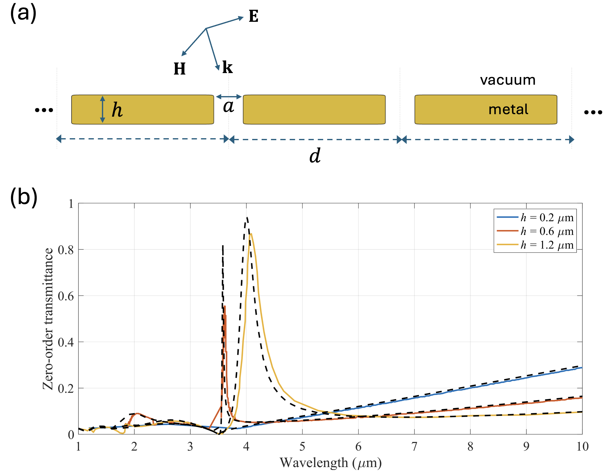

# sim1dperiodic: Spectral Integral Method for 1-D Periodic Gratings

MATLAB implementation of the spectral integral method (SIM) for scattering of a plane wave by a one-dimensional periodic array (grating) of identical, homogeneous, smooth cylinders. The code computes the complex Floquet amplitudes of all propagating diffraction orders and the reflectance, transmittance, and absorptance, in both TE<sub>z</sub> and TM<sub>z</sub> polarizations, for lossless dielectrics and for lossy or plasmonic materials with complex permittivity (e.g., gold in the visible and infrared).

<p align="center">
  
</p>
<p align="center"><em>(a) Geometry; (b) zero-order transmittance, SIM (black) vs. Porto et al. (colored).</em></p>

Main features:

- Arbitrary angle of incidence, TE<sub>z</sub> (H<sub>z</sub>) and TM<sub>z</sub> (E<sub>z</sub>) in a single formulation
- Complex permittivity with negative real part (metals, plasmonics)
- Quasi-periodic Green's function in the Ewald representation, evaluated with the Faddeeva function (valid for complex arguments)
- Windowed singularity subtraction, which keeps exponential convergence for large and strongly lossy scatterers
- Any smooth closed cross-section (circle, ellipse, perturbed ellipse, rose curve, superellipse / rounded rectangle, or a user-defined curve)
- Energy-balance residual returned as an accuracy diagnostic
- Independent multipole (lattice-sum) reference solver for circular cylinders, used for validation

## Requirements

- MATLAB (R2019b or later recommended; `exportgraphics` is used in some examples)
- No toolboxes are required by the solver
- Parallel Computing Toolbox is optional; several examples use `parfor`/`parpool` and run serially if the pool lines are commented out and `parfor` is replaced by `for`

## Quick start

```matlab
% gold circular cylinders, radius 100 nm, period 500 nm, 633 nm, TE_z, 15 deg incidence
geom = struct('type','circle','a',100);          % lengths in nm
opts = struct('pol','TE','thetai',15*pi/180);
o = sim1dperiodic(geom, 633, eps_gold(633), 64, 500, opts);

o.orders, o.Rn, o.Tn          % propagating Floquet orders and complex amplitudes
[o.R, o.T, o.A]               % reflectance, transmittance, absorptance
o.energy_residual             % 1 - R - T - A

% independent reference for circular cylinders (multipole / lattice-sum method)
M = mpm1d(100, 633, eps_gold(633), 500, opts);
max(abs([o.Rn - M.Rn; o.Tn - M.Tn]))
```

## Conventions

- Time dependence exp(-iωt); lossy media have Im ε > 0
- Lengths in any consistent unit (the examples use nm); angles in radians
- Cylinders are centred at (p·d, 0), p integer; the period d is along x
- The incident plane wave comes from y > 0 at angle `thetai` measured from the -y axis (positive towards +x)
- TE<sub>z</sub>: the unknown is H<sub>z</sub>; TM<sub>z</sub>: the unknown is E<sub>z</sub>
- The cross-section must fit inside one period, |x| < d/2; its height along y is unrestricted
- N (number of boundary points) must be even

## Main function

```matlab
out = sim1dperiodic(geom, lam, epsr, N, d, opts)
```

| Input | Description |
|---|---|
| `geom` | Geometry structure (see below) |
| `lam` | Free-space wavelength |
| `epsr` | Relative permittivity of the cylinders (complex allowed) |
| `N` | Number of boundary points (even) |
| `d` | Period |
| `opts.pol` | `'TE'` (default) or `'TM'` |
| `opts.thetai` | Angle of incidence in radians (default 0) |
| `opts.epsb` | Background permittivity (default 1) |
| `opts.Lcut`, `opts.Lon` | Window parameters of the singularity subtraction (defaults 8 and 18) |
| `opts.H` | Ewald splitting parameter (default 1.5) |

| Output | Description |
|---|---|
| `out.orders` | Propagating Floquet orders n |
| `out.Rn`, `out.Tn` | Complex reflection and transmission amplitudes of each order |
| `out.R`, `out.T`, `out.A` | Reflectance, transmittance, absorptance |
| `out.energy_residual` | 1 - R - T - A |
| `out.beta_n`, `out.gamma_n` | Tangential and normal wavenumbers of the orders |

Geometry types:

| `geom.type` | Fields | Shape |
|---|---|---|
| `'circle'` | `a` | Circle of radius a |
| `'ellipse'` | `a`, `b` | Ellipse with semi-axes a (x) and b (y) |
| `'pert'` | `a`, `b` | Smoothly perturbed ellipse |
| `'rose'` | `a`, `d`, `m` | Rose curve ρ(t) = a(1 + d cos mt) |
| `'custom'` | `fun` | `[r, dr, ddr] = fun(t)`, each 2×N, for t in [0, 2π) |

`superellipse_geom` and `rounded_rect_geom` return ready-to-use `'custom'` geometries for nearly rectangular cross-sections.

## Files

### Solver and subroutines

| File | Description |
|---|---|
| `sim1dperiodic.m` | Main SIM solver for 1-D periodic gratings |
| `greenper1d.m` | 1-D quasi-periodic Green's function (Ewald representation) and its gradient |
| `faddeeva_w.m` | Faddeeva function w(z) for complex z (Weideman's rational approximation) |
| `lattice_sums_1d.m` | Lattice sums of a 1-D array, used by the multipole reference |
| `mpm1d.m` | Independent multipole (lattice-sum) solver for gratings of circular cylinders |
| `mie_cyl.m` | Exact Mie series for a single circular cylinder (TE<sub>z</sub>/TM<sub>z</sub>, complex permittivity) |
| `superellipse_geom.m` | Analytic superellipse (nearly rectangular) geometry |
| `rounded_rect_geom.m` | Superellipse with equal-arclength parametrization, for long thin bars and sharp corners |
| `eps_gold.m` | Gold permittivity, Etchegoin analytic model (about 400 to 1000 nm) or user-supplied table |
| `eps_gold_drude_ir.m` | Gold Drude permittivity in the infrared (Ordal parameters) |
| `eps_bk7.m` | N-BK7 glass permittivity (Schott Sellmeier formula) |
| `example_rectangle.m` | Convergence in N for nearly rectangular gold cylinders and several superellipse exponents |
| `multipole_truncation.m` | Effect of multipole truncation on the TE reflection band near the Rayleigh anomaly |

### Examples (`z_*.m`)

| File | Description |
|---|---|
| `z_example_grating.m` | R/T/A spectrum of a gold elliptical nanowire grating (TE<sub>z</sub>) |
| `z_check_GreensFunction_Accuracy.m` | Ewald Green's function versus direct spectral sum |
| `z_validate_sim1dperiodic.m` | Full validation against the multipole solution: accuracy vs N, gap effect, spectra |
| `z_plot_SIM_accuracy.m` | Accuracy versus N for five test gratings, TE<sub>z</sub> and TM<sub>z</sub> |
| `z_plot_SIM_N_requirement.m` | Required N versus perimeter/gap ratio for closely spaced cylinders |
| `z_plot_SIM_vs_MPM_RT_lam_Au.m` | SIM vs multipole, R/T versus wavelength, gold grating |
| `z_plot_SIM_vs_MPM_RT_lam_glass.m` | SIM vs multipole, R/T versus wavelength, glass grating |
| `z_plot_SIM_vs_MPM_RT_theta_Au.m` | SIM vs multipole, R/T versus angle of incidence, gold grating |
| `z_plot_RTA_lam_vs_theta.m` | R/T/A maps versus wavelength and angle, gold grating, TE<sub>z</sub> |
| `z_plot_RTA_lam_vs_theta_TM.m` | Same as above for TM<sub>z</sub> |
| `z_plot_RTA_lam_vs_theta_glass.m` | R/T/A maps versus wavelength and angle, glass grating |
| `z_wood_benchmark.m` | SIM vs multipole approaching a Rayleigh-Wood anomaly |
| `z_plot_rect_grating.m` | Visualization of a grating of nearly rectangular cylinders |
| `z_Porto1999_fig1.m` | Reproduction of Fig. 1 of Porto, García-Vidal, and Pendry, PRL 83, 2845 (1999) |
| `z_timing_vs_N.m` | Compute time versus N for gold and BK7 gratings |
| `Porto1999_fig1_data.mat` | Precomputed results of `z_Porto1999_fig1.m` |

## Practical notes

- Start with N of a few points per wavelength along the boundary and confirm convergence by doubling N; the energy residual is a useful but not sufficient check.
- Closely spaced cylinders need more points: for a gap g = d - 2a, roughly N ≈ 4.1 (2πa/g) + 14 for 10<sup>-10</sup> accuracy (gold, 633 nm).
- Nearly rectangular shapes converge more slowly as the superellipse exponent p grows, because the corner radius scales as 1/p.
- The quasi-periodic Green's function is singular exactly at a Rayleigh-Wood anomaly (a diffraction order grazing the grating); avoid evaluating exactly there. Accuracy degrades only slowly as the anomaly is approached.

## Citation

If you use this code, please cite:

> E. Simsek, "Spectral integral method for one-dimensional periodic gratings of dielectric and metallic cylinders," in preparation.

> E. Simsek, "Windowed singularity subtraction for the spectral integral method," submitted to IEEE Transactions on Antennas and Propagation.

## Author

Ergun Simsek, University of Maryland Baltimore County (UMBC), simsek@umbc.edu
